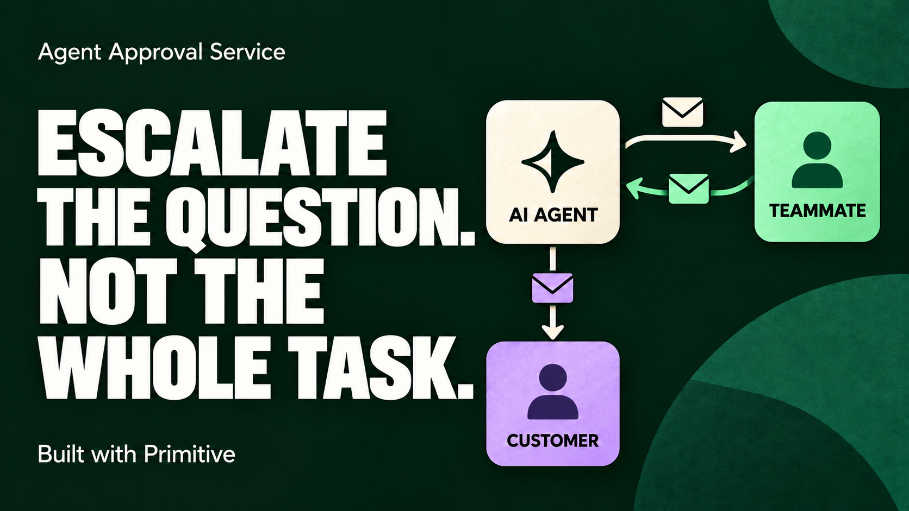

# Fluffy

**Human help and approval for AI agents.**

Fluffy lets an agent email a configured teammate for missing answers or permission, then resume its task. Human teammates contribute expertise and approval without taking over the whole customer conversation.

While building AI customer support for customers like Partiful, we saw knowledge gaps turn into full-ticket handoffs. Fluffy explores a smaller request: ask the human for the missing piece, so the agent can resolve more tickets from start to finish. The eyewear workflow below demonstrates that pattern; it is not a Partiful integration.

| The agent needs…         | It sends…                                      | The reply provides…             |
| ------------------------ | ---------------------------------------------- | ------------------------------- |
| Information or expertise | A focused question with supporting attachments | An answer; no permission to act |
| Authority to act         | The exact proposed action for review           | Permission for that action only |

Built for YC's **Make Something Agents Want** hackathon, Primitive's **Best Agent Communication Setup** track.

**[Watch the 2-minute Fluffy demo](https://youtu.be/THKHfZs5Poc)** · [Architecture](docs/architecture.md) · [Verification and limits](docs/verification.md)

[](https://youtu.be/THKHfZs5Poc)

[System overview](docs/system-overview.png) · [Editable Excalidraw](docs/system-overview.excalidraw)

## The demo

A support agent collects prescription intake information for an eyewear order:

1. The customer emails a prescription image to the agent's own address.
2. The agent requests missing details with a fillable PDF.
3. The customer returns the form and asks a question the agent cannot answer.
4. The agent emails a teammate the question and supporting attachments.
5. The teammate replies with the answer. The same agent session resumes.
6. Completing intake requires approval. The teammate reviews the exact proposed customer message and approves by replying to the email.
7. Primitive executes the approved action and sends a receipt. The agent records completion and continues helping the customer.

The teammate supplies an answer or permission; they never take over the case. Review attachments stay internal.

## Run it locally

Want to connect your own inbox? Follow the [step-by-step own-instance guide](docs/own-instance.md), starting with the credential-free demo.

Requires **Node.js 24**. No credentials are needed for the default checks.

```sh
npm ci
npm run demo
npm run verify
```

`demo` exercises the complete attachment → form → teammate answer → approval → completion journey through the actual services, using a deterministic model adapter and in-memory mail transport. It sends no real emails. `verify` runs the test suite, checks formatting, and builds both Primitive Functions. Real hosted email and model verification are documented separately in [verification](docs/verification.md).

## Read the code in this order

`src/` contains reusable infrastructure. `agents/support/` supplies the eyewear application. `scripts/` builds and deploys them; `tests/` connects them without live credentials.

| Start here                                                                                       | What to look for                                                              |
| ------------------------------------------------------------------------------------------------ | ----------------------------------------------------------------------------- |
| [Inbox entrypoint](src/functions/inbox.mjs) → [bridge](src/inbox/bridge.mjs)                     | How an incoming email becomes an authenticated agent event                    |
| [Support agent wiring](agents/support/server.mjs) → [tools and policy](agents/support/tools.mjs) | The application plugged into the shared runtime and gateway                   |
| [Agent service](src/agent/service.mjs)                                                           | Saved sessions, pending work, receipts, and resumption                        |
| [Tool gateway](src/gateway/gateway.mjs)                                                          | Trusted policy and independent Jev assessment before registered tools run     |
| [Question service](src/questions/service.mjs) / [approval service](src/approval/service.mjs)     | Information replies versus one-use permission for an exact action             |
| [Complete workflow test](tests/intake-flow.test.mjs)                                             | The whole journey, with test adapters first and the email scenario below them |

Two small composition roots wire these parts together: [`inbox.mjs`](src/functions/inbox.mjs) and [`approval.mjs`](src/functions/approval.mjs). Shared code in `src/` has no imports from the support application, except where a composition root explicitly wires it in. An [architecture test](src/architecture.test.mjs) enforces that boundary.

## What Primitive does

| Primitive capability                   | Role in this project                                                              |
| -------------------------------------- | --------------------------------------------------------------------------------- |
| Email identities and inbound Functions | Give the agent an address and trigger work from customer and teammate replies     |
| Attachments                            | Carry the prescription, fillable form, returned PDF, and internal review evidence |
| Memories                               | Store email checkpoints, questions, permissions, and delivery state               |
| Wake                                   | Dispatch an approved action asynchronously, then return an execution receipt      |
| Native logs                            | Show tool decisions and session resumption during the demo                        |

The live workflow uses **two Primitive Functions and one Claude runtime**. The recorded deployment uses Blaxel; the runtime can also run on your own Node host. The approval service is code inside the internal mailbox Function. Decisions happen by email, with no separate approval web app. Jev checks tool calls in the trusted gateway and assesses requests again in the mailbox Function.

## Reuse and deployment

The support agent is one application. The gateway, session runtime, inbox bridge, questions, and approval protocol are reusable. Another application supplies its tools, policy, and trusted action validator; another harness can call `ToolGateway` directly. See [architecture and reuse](docs/architecture.md).

For a real inbox, start with the [own-instance setup guide](docs/own-instance.md); [deployment and operations](docs/operations.md) covers operational details. Versioned configuration files are examples; live resource IDs, credentials, state, and rehearsal logs are excluded from Git. [Live walkthrough instructions](docs/demo.md) describe the email roles and preparation.

This example records administrative intake for a configured example order, with isolated cases per customer thread. Customer access can use an allowlist or accept any email-authenticated sender. It does not perform clinical validation, integrate with a production order system, or fulfill an order. See [verification and limits](docs/verification.md) for exactly what was tested.
