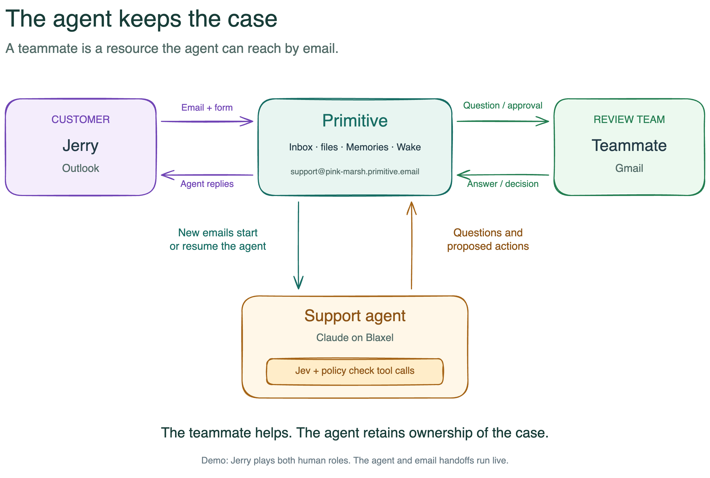

# Agent Approval Service

**An agent can ask a teammate for help by email without handing over the case.**

When an agent lacks information or authority, it emails the right teammate, waits for a reply, and continues the same task. A question supplies information; an approval permits one exact action. The agent keeps ownership of the customer conversation.

Built for YC's **Make Something Agents Want** hackathon, Primitive's **Best Agent Communication Setup** track.

**[Watch the 1:58 demo](https://github.com/jerrychangusa/agent-approval-service/releases/download/v1.0.0/demo-final-elevenlabs.io.mp4)** · [Architecture](docs/architecture.md) · [Verification and limits](docs/verification.md)



[Editable Excalidraw overview](docs/system-overview.excalidraw)

## The demo

A support agent collects prescription intake information for an eyewear order:

1. The customer emails a prescription image to the agent's own address.
2. The agent requests missing details with a fillable PDF.
3. The customer returns the form and asks a question the agent cannot answer.
4. The agent emails a teammate the question and supporting attachments.
5. The teammate replies with the answer. The same agent session resumes.
6. Completing intake requires approval. The teammate reviews the exact proposed customer message and approves by replying to the email.
7. Primitive executes the approved action and sends a receipt. The agent records completion and continues helping the customer.

The teammate supplies an answer or permission; they never take over the case. Review attachments stay internal.

## Run it locally

Requires **Node.js 24**. No credentials are needed for the default checks.

```sh
npm ci
npm run demo
npm run verify
```

`demo` exercises the complete attachment → form → teammate answer → approval → completion journey through the actual services, using a deterministic model adapter and in-memory mail transport. It sends no real emails. `verify` runs all **115 tests**, checks formatting, and builds both Primitive Functions. Real hosted email and model verification are documented separately in [verification](docs/verification.md).

## Read the code in this order

| Start here                                                                   | What to look for                                                                            |
| ---------------------------------------------------------------------------- | ------------------------------------------------------------------------------------------- |
| [Complete workflow test](tests/intake-flow.test.mjs)                         | One executable example connecting every component                                           |
| [Inbox entrypoint](src/functions/inbox.mjs) → [bridge](src/inbox/bridge.mjs) | Inbound email, attachments, sender checks, and duplicate-event checkpoints                  |
| [Agent service](src/agent/service.mjs)                                       | Persistent sessions, pending work, receipt handling, and resumption                         |
| [Tool gateway](src/gateway/gateway.mjs)                                      | Every registered tool passes trusted policy checks and independent Jev assessment           |
| [Question service](src/questions/service.mjs)                                | Ask a configured teammate; treat the reply as information, without granting authority       |
| [Approval service](src/approval/service.mjs)                                 | Freeze an exact action, authenticate a decision, dispatch execution, and reconcile delivery |
| [Support agent](agents/support/README.md)                                    | Application tools, messages, form fields, and case state                                    |

Two small composition roots wire these parts together: [`inbox.mjs`](src/functions/inbox.mjs) and [`approval.mjs`](src/functions/approval.mjs). Shared code in `src/` has no imports from the support application, except where these roots explicitly wire it in. An [architecture test](src/architecture.test.mjs) enforces that boundary.

## What Primitive does

| Primitive capability                   | Role in this project                                                              |
| -------------------------------------- | --------------------------------------------------------------------------------- |
| Email identities and inbound Functions | Give the agent an address and trigger work from customer and teammate replies     |
| Attachments                            | Carry the prescription, fillable form, returned PDF, and internal review evidence |
| Memories                               | Store email checkpoints, questions, permissions, and delivery state               |
| Wake                                   | Dispatch an approved action asynchronously, then return an execution receipt      |
| Native logs                            | Show tool decisions and session resumption during the demo                        |

There are **two Primitive Functions and one Claude runtime on Blaxel**. The approval service is code inside the internal mailbox Function. Decisions happen by email, with no separate approval web app. Jev checks tool calls in the trusted gateway and assesses requests again in the mailbox Function.

## Reuse and deployment

The support agent is one application. The gateway, session runtime, inbox bridge, questions, and approval protocol are reusable. Another application supplies its tools, policy, and trusted action validator; another harness can call `ToolGateway` directly. See [architecture and reuse](docs/architecture.md).

For a real inbox, follow [deployment and operations](docs/operations.md). Versioned configuration files are examples; live resource IDs, credentials, state, and rehearsal logs are excluded from Git. [Live walkthrough instructions](docs/demo.md) describe the email roles and preparation.

This example records administrative intake for one configured customer and order. It does not perform clinical validation, integrate with a production order system, or fulfill an order. See [verification and limits](docs/verification.md) for exactly what was tested.
